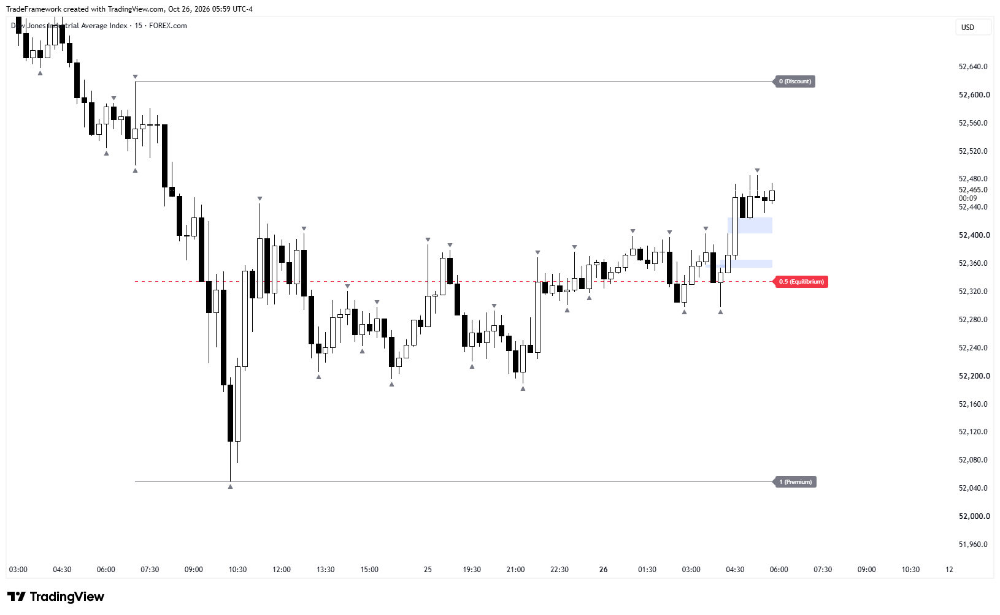
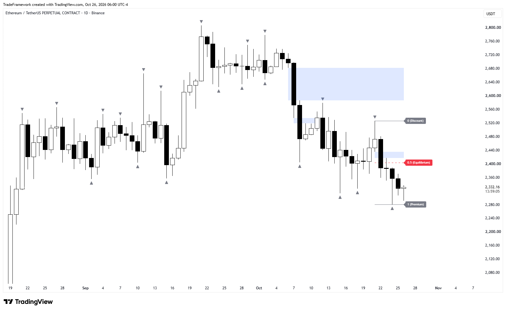
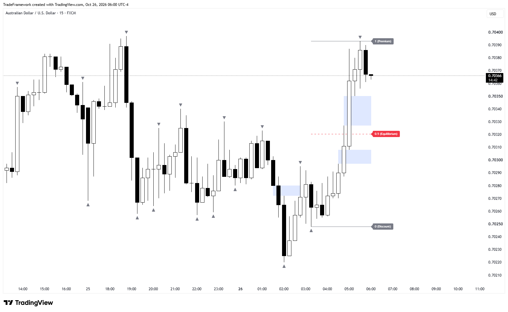

# Fractal Fibonacci

**Fractal-based dealing range with Fibonacci levels and imbalances for TradingView**

---

## 📸 Preview

  

### More examples

| Example 2 | Example 3 |
|:---:|:---:|
|  |  |

*Screenshots illustrate how the indicator draws levels and do not guarantee trading results.*

---

## 🔎 What it does

Fractal Fibonacci builds the **dealing range** automatically from market fractals and splits it into **premium**, **equilibrium** and **discount** with Fibonacci levels.

### How it works

**1. Fractals.** A fractal is a local turning point: a bar whose high is above the highs of the bars on both sides (fractal high), or whose low is below the lows of the bars on both sides (fractal low). The classic Bill Williams fractal uses 5 bars, two on each side. A 3 bar version, one bar on each side, is also available and reacts to shorter swings. A fractal is confirmed only after the following bars have formed, so every triangle appears a few bars after the turning point.

**2. Dealing range.** The latest fractal high and fractal low define the dealing range: the price leg the market is currently trading in. The term comes from ICT and Smart Money Concepts. When a new fractal breaks out of the range, the range is rebuilt: the broken edge moves to the new fractal, and the opposite edge is re-anchored to the most recent opposite fractal inside the previous range. Only the current range is displayed.

**3. Fibonacci levels.** Three levels are drawn across the range and extended to the current bar:

| Level | Position | Label |
|:---:|---|---|
| **1** | Range high | 1 (Premium) |
| **0.5** | Middle of the range | 0.5 (Equilibrium) |
| **0** | Range low | 0 (Discount) |

Price above 0.5 trades in the **premium** half of the range, price below 0.5 in the **discount** half. Traders who use ICT concepts typically look for buying interest in discount and selling interest in premium, and treat the equilibrium as a reference point. The indicator only maps the range, how you use it is up to you.

**4. Imbalances (optional).** The latest fair value gaps are drawn as boxes. A gap stops extending once price enters it.

## ✨ Features

- **3 or 5 bar fractals** with an adjustable confirmation period
- **Automatic dealing range** that rebuilds itself when a new fractal breaks it
- **Premium, equilibrium and discount** levels (1, 0.5, 0) with labels
- **Separate settings for every level:** color, width and line style
- **Imbalances (fair value gaps)** as boxes that stop extending after price enters them
- **Label size and offset** settings

## 🤝 Works well with

**[Liquidity Sweeps MTF](https://github.com/Metaprogramlabs/liquidity-sweeps-mtf)** is a companion indicator from the same author. It marks where price takes higher-timeframe liquidity, while Fractal Fibonacci shows where that happens inside the current dealing range: in the premium or discount half, and relative to equilibrium. Used together, you see the liquidity sweep and the range context on one chart.

## ⚙️ Settings

### Fractals

| Setting | Default | Description |
|---|---|---|
| Show fractals | on | Marks fractals with gray triangles |
| Fractal periods | 2 | Number of bars after which a fractal is confirmed (2 to 10) |
| 3 or 5 bar fractal | 5 | Fractal pattern size |

### Levels

Every level has its own group in the menu. Level 0 is the lower edge of the range, level 1 is the upper edge.

| Level | Color | Width | Style |
|---|---|---|---|
| Level 0 | Gray | 1 | Solid |
| Level 0.5 | Red | 1 | Dashed |
| Level 1 | Gray | 1 | Solid |

Color, width (1 to 5) and style (Solid, Dashed, Dotted) can be changed for each level.

### Labels

| Setting | Default | Description |
|---|---|---|
| Label size | small | tiny, small, normal, large or huge |
| Label offset (bars) | 0 | Moves labels to the right of the last bar |

### Imbalances (FVG)

| Setting | Default | Description |
|---|---|---|
| Show imbalances (FVG) | on | Draws fair value gaps as boxes |
| Number of imbalances | 5 | How many of the latest gaps are kept (1 to 20) |
| Imbalance (FVG) color | Blue, 85% transparent | Fill color of the boxes |

## 🚀 Installation

1. Open any chart on [TradingView](https://www.tradingview.com/).
2. Open the **Pine Editor** at the bottom of the screen.
3. Copy the contents of the `.pine` file from this repository into the editor.
4. Click **Add to chart**.

## 📝 Notes

- A fractal needs the following bars to confirm it, so it appears a few bars after it formed (the number of bars is set by *Fractal periods*).
- The indicator can draw up to 500 lines and 500 labels.
- This is a charting tool. It does not predict price and is not financial advice.

## 📄 License

**© 2026 Meta Program Labs. All rights reserved.**

The source code is open for viewing and for personal, non-commercial use on your own TradingView account. Copying, modification, redistribution, republishing and commercial use require written permission. See [LICENSE](LICENSE) for details.

## 📬 Author

**Meta Program Labs**

---

<b>🇷🇺 На русском</b>

 

### Fractal Fibonacci

Индикатор для TradingView: автоматически строит **дилинг-рейндж (dealing range)** по фракталам и делит его на **премиум**, **эквилибриум** и **дискаунт** уровнями Фибоначчи.

**Как это работает:**
1. **Фракталы.** Фрактал это локальная точка разворота: свеча, у которой хай выше хаёв соседних свечей с обеих сторон (верхний фрактал), или лоу ниже лоёв соседей (нижний фрактал). Классический фрактал Билла Вильямса использует 5 свечей (по две с каждой стороны), также доступен вариант из 3 свечей для более коротких свингов. Фрактал подтверждается только после следующих свечей, поэтому треугольник появляется с задержкой в несколько баров.
2. **Дилинг-рейндж.** Последние верхний и нижний фракталы задают диапазон, в котором сейчас торгуется цена (термин из ICT и Smart Money Concepts). Когда новый фрактал пробивает диапазон, он перестраивается: пробитая граница переносится на новый фрактал, а противоположная перепривязывается к ближайшему свежему противоположному фракталу внутри прежнего диапазона. На графике показан только текущий диапазон.
3. **Уровни Фибоначчи.** 1 (Premium) это верх диапазона, 0.5 (Equilibrium) середина, 0 (Discount) низ. Цена выше 0.5 находится в премиум-половине диапазона, ниже 0.5 в дискаунт-половине.
4. **Имбалансы (FVG).** Последние разрывы справедливой стоимости рисуются боксами и перестают растягиваться, когда цена заходит в них.

**Хорошо работает в паре с** [Liquidity Sweeps MTF](https://github.com/Metaprogramlabs/liquidity-sweeps-mtf): тот индикатор отмечает снятие ликвидности на старших таймфреймах, а Fractal Fibonacci показывает, где это происходит внутри текущего диапазона (в премиуме или дискаунте, относительно эквилибриума).

**Возможности:** фракталы по 3 или 5 свечам с настраиваемым периодом подтверждения, автоматическое обновление диапазона, отдельные настройки каждого уровня (цвет, толщина, стиль линии), имбалансы, размер и отступ подписей.

**По умолчанию:** уровни 0 и 1 серые, сплошные, толщина 1; уровень 0.5 красный, пунктирный, толщина 1.

**Установка:** откройте Pine Editor в TradingView, вставьте код из `.pine` файла и нажмите Add to chart.

**Лицензия:** © 2026 Meta Program Labs, все права защищены. Код открыт для просмотра и личного некоммерческого использования на своём аккаунте TradingView. Копирование, изменение, распространение и коммерческое использование без письменного разрешения запрещены.

**Автор:** [Telegram-канал](https://t.me/Metaprogramlabs)

